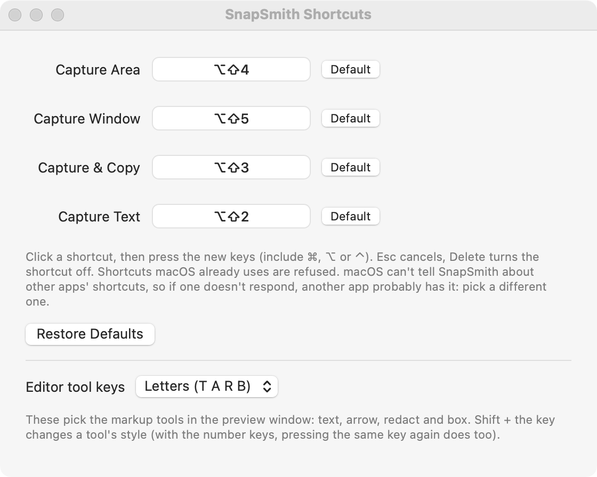
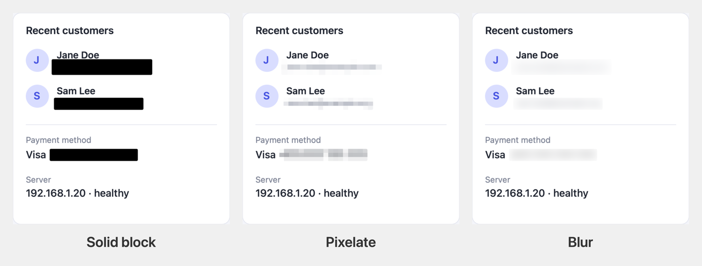
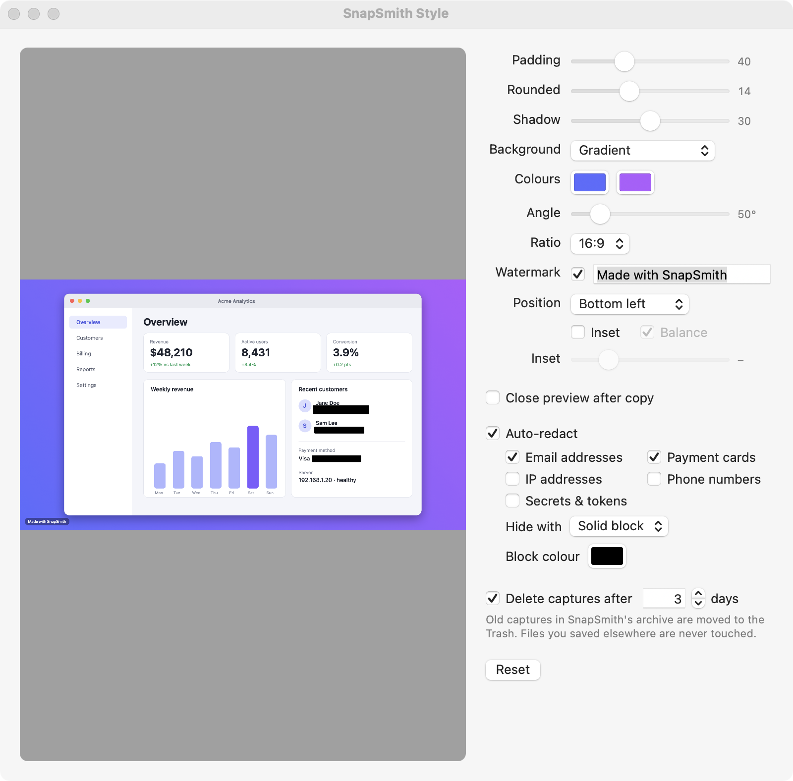

<h1 align="center">SnapSmith</h1>

<p align="center">
  A macOS menu-bar app for taking good-looking screenshots.<br>
  Capture, mark up, hide sensitive text, and copy a polished image, all on-device.
</p>

<p align="center">
  
</p>

<table>
  <tr>
    <td align="center"><b>Before</b>: the raw capture</td>
    <td align="center"><b>After</b>: one shortcut and a few clicks</td>
  </tr>
  <tr>
    <td></td>
    <td></td>
  </tr>
</table>

*The dashboard above is made up (fake names, emails and card number) and was run through SnapSmith itself.*

## Features

- **Capture** an area or a window with global shortcuts, or copy the text out of any part of the screen (OCR).
- **Beautify**: put the capture on a gradient, your wallpaper or any picture, with padding, rounded corners, a shadow, a canvas shape for social posts (16:9, 1:1, 4:5…) and an optional watermark badge.
- **Mark up** with text labels, arrows (four styles), boxes, ellipses and highlights, in any colour.
- **Redact**: automatically hide email addresses, payment cards, IP addresses, phone numbers and secrets such as API keys and tokens. Cover them with a solid block, pixelate or blur, then fix mistakes by hand.
- **Private**: capture, text recognition and rendering all happen on your Mac. Nothing is uploaded.
- **Tidy**: old captures are moved to the Trash automatically (3 days by default).

## Install

You need a Mac running macOS 11 or later (developed and tested on macOS 14) and Apple's command-line tools. If you've never installed them, run `xcode-select --install` first.

```sh
git clone https://github.com/adhiprs/snapsmith.git
cd snapsmith
./scripts/install.sh
```

That builds the app, signs it, puts **SnapSmith.app** in your Applications folder and opens it. The first build takes a minute or two. macOS asks for your password once, to trust a local signing certificate (see [Why a signing certificate?](#why-a-signing-certificate)). If a second dialog asks whether `codesign` may use the new key, choose **Always Allow**; otherwise the build waits for your answer.

### First launch: allow screen recording

macOS won't let any app read your screen until you say so.

1. When the prompt appears, open **System Settings → Privacy & Security → Screen Recording** and switch on **SnapSmith**.
2. **Quit SnapSmith and open it again** (menu bar camera icon → Quit). macOS only applies the permission after the app restarts.

Without that permission, captures come out as just your desktop wallpaper.

## Your first screenshot in 30 seconds

1. Press **⌥⇧4** (Option + Shift + 4) and drag over part of your screen. Press Space to pick a window instead.
2. A preview window opens. Tick **Beautify** to add the background, shadow and padding.
3. Optionally press **T**, **A**, **R** or **B** to add text, an arrow, a redaction or a box (see [Markup tools](#markup-tools)).
4. Press **⌘C** (or click **Copy**), then paste anywhere.

Want to skip the preview? **⌥⇧3** captures an area and copies the finished image straight away.

<p align="center">
  
</p>

## Shortcuts

| Shortcut | Action |
| --- | --- |
| **⌥⇧4** | Capture an area (press Space to switch to window picking) |
| **⌥⇧5** | Capture a window |
| **⌥⇧3** | Capture an area and copy it straight away, without the preview |
| **⌥⇧2** | Capture an area and copy the text in it |

Change them under **menu bar icon → Shortcuts…**: click a shortcut, press the new keys (include ⌘, ⌥ or ⌃), Esc to cancel, Delete to turn it off. Shortcuts macOS already uses (⇧⌘3/4/5, ⌘Space, and anything else enabled in System Settings → Keyboard → Keyboard Shortcuts) are refused. macOS doesn't let apps see each other's shortcuts, so if one doesn't respond, another app probably has it: pick a different one.

The same window has an **Editor tool keys** setting: **Letters (T A R B)** by default, or **Numbers (1–4)** if you prefer those (see [Markup tools](#markup-tools)).

<p align="center">
  
</p>

## Using the preview window

- **Copy** (⌘C or Return) copies the image, styled if Beautify is on. **Save…** (⌘S) saves a PNG (to the Desktop by default). **Close** (Esc) closes without copying.
- **Beautify**, **Inset**, **Padding** and **Redact** are sticky: whatever you set becomes the default for the next capture. **Style…** opens the full settings.
- **Close after copy** (on by default) closes the window once you copy.
- **Inset** trims the empty margin around a capture that sits on a plain background, then re-pads it evenly.

### Markup tools

The tools are in the toolbar and on the keyboard. When a tool is active, a strip under the toolbar shows its options: a style picker, text size, and a colour.

| Key | Tool | How | Styles (picker, or Shift + the key) |
| --- | --- | --- | --- |
| **T** | Text | Click, type, press Return | Label (a filled badge) or plain text. Size S / M / L or a free slider |
| **A** | Arrow | Drag from the tail to the tip | Pointer, open head, curved, double-headed |
| **R** | Redact | Click a black block to show that text again, click any word to hide it, or drag to draw a box | Solid block, pixelate, blur |
| **B** | Box | Drag | Box, ellipse, highlight, line |

- **Shift + the key** cycles the active tool's style: Shift+A for arrows, Shift+B for shapes, Shift+T for the text size, Shift+R for how redaction hides text.
- **Colour:** the colour well in the strip sets the colour for new text, arrows and shapes; markup you already drew keeps its colour.
- **Esc** leaves the tool (with no tool active, Esc closes the window). **⌘Z** undoes markup and redaction edits.
- While a tool is active the preview shows the plain capture, so your clicks land exactly where you aim. Markup starts fresh with each new capture.
- **Prefer the number keys?** In **Shortcuts… → Editor tool keys**, choose **Numbers (1–4)**: 1 text, 2 arrow, 3 redact, 4 shape. With numbers, pressing a tool's key again also cycles its style.

<p align="center">
  
</p>

### Redact

Turn on **Redact** and SnapSmith reads the capture's text on your Mac and hides what it recognises as sensitive. The note next to the checkbox shows how many items were hidden (hover it for the list). Copy and Save wait for the scan to finish, so an unredacted image never reaches your clipboard.

| Category | Examples it catches |
| --- | --- |
| Email addresses | `jane.doe@example.com` |
| Payment cards | 13–19 digit numbers that pass the Luhn check |
| IP addresses | IPv4 and IPv6 |
| Phone numbers | `+62 812-3456-7890`, `(555) 123-4567`, `0812 3456 7890` |
| Secrets & tokens | long API keys, prefixed tokens (`ghp_…`, `sk_…`), JWTs |

Only email addresses are on by default; pick the rest in Style Settings. **Hide with** chooses how matches are covered, and the same choice applies to anything you hide by hand with the Redact tool:

<p align="center">
  
</p>

**Use the solid block for anything sensitive.** Pixelate and blur leave a faint trace of the original in the image, and such traces can sometimes be partly reversed. They suit softening incidental details, such as names in a demo, but not passwords or card numbers.

Detection is best-effort: it can miss text it can't read, and it can hide harmless text that looks like a secret. Always look at the result before sharing something sensitive, and use the Redact tool (**R**) to fix anything it got wrong.

## Style settings

Open **menu bar icon → Style Settings…** (⌘,). Changes show up live on your latest capture.

<p align="center">
  
</p>

| Setting | What it does |
| --- | --- |
| Padding, Rounded, Shadow | The look of the card around your capture |
| Background | A gradient (pick two colours and an angle), your **desktop wallpaper**, or any **image** |
| Ratio | Free, or 16:9, 4:3, 3:2, 1:1, 4:5, 9:16 for posts and slides |
| Watermark | A small badge with your text in a corner of the canvas (bottom left, centre or right). If the padding is too thin to hold it, only the bottom edge grows |
| Auto-redact | Which kinds of text to hide, how to hide it (solid block, pixelate, blur), and the block colour |
| Delete captures after … days | Old captures go to the Trash automatically; turn it off to keep everything |

## Where your captures go

`~/Library/Application Support/SnapSmith/Archives/`, with `Originals/` for captures as taken and `Edited/` for the version with redaction, markup and styling applied. Files are named like `SnapSmith 2026-10-12 at 09.30.15.png`. Use **menu bar icon → Open Archive Folder** to jump there.

Captures older than 3 days are moved to the **Trash** (not deleted outright) at launch, after each capture, and hourly. Change the number of days, or turn it off, in Style Settings. Only SnapSmith's own `SnapSmith … .png` files in those two folders are touched. Anything you saved with **Save…** stays where you put it.

## Troubleshooting

| Problem | Fix |
| --- | --- |
| Captures show only my wallpaper | Screen Recording isn't allowed yet. Switch on SnapSmith in System Settings → Privacy & Security → Screen Recording, then **quit and reopen** SnapSmith. |
| It keeps asking for permission even though it's switched on | The list has a stale entry. Select SnapSmith in the Screen Recording list and remove it with **−**, then run `tccutil reset ScreenCapture id.selepaskerja.snapsmith` and reopen the app. |
| A shortcut does nothing | Another app probably owns it. Pick a different one in **Shortcuts…**. |
| I can't see the menu bar icon | Look for the camera icon at the top right. On a crowded menu bar (or a notch), quit another menu-bar app to make room. |
| Permission is asked again after every rebuild | You're signing ad-hoc. Run `./scripts/make-signing-cert.sh` once, then rebuild. |
| `swift: command not found` | Run `xcode-select --install`, then `./scripts/install.sh` again. |
| macOS says SnapSmith "can't be opened" | That happens to apps copied from another Mac. Build it on your own Mac with `./scripts/install.sh`, or right-click the app and choose **Open**. |
| Redact missed something | Detection is best-effort. Switch to the Redact tool (**R**) and click the word, or drag a box over it. |
| I want the number keys (1–4) for the tools | Open **Shortcuts… → Editor tool keys** and choose **Numbers (1–4)**. |
| Pressing a letter in the editor does nothing | Click an empty part of the preview first: keys go to whichever control has focus. While typing into a text label, letters are just text. |

## Update, move, or remove

- **Update:** `git pull`, then `./scripts/install.sh`. Your settings are kept.
- **Install somewhere else:** `INSTALL_DIR="$HOME/Applications" ./scripts/install.sh`.
- **Open at login:** menu bar icon → **Open at Login** (macOS 13 or later).
- **Uninstall:** `./scripts/uninstall.sh` removes the app and keeps your settings and captures. Add `--purge` to remove those too.

### Why a signing certificate?

macOS ties the Screen Recording permission to how an app is signed. An ad-hoc signed app is identified by its exact code, so every rebuild looks like a new app and loses the permission. `install.sh` creates a self-signed certificate called "SnapSmith Local Signing" in your login keychain, so macOS recognises each rebuild as the same app. The certificate is trusted for code signing for your user only and never leaves your Mac. To remove it, delete it in Keychain Access.

## For developers

```sh
swift build                     # debug build
swift run SnapSmith             # run without installing
./scripts/bundle.sh             # build build/SnapSmith.app (signs with the local certificate if present)
BUNDLE_ID=com.you.snapsmith ./scripts/bundle.sh   # use your own bundle ID (forks should)
```

`swift run` works, but macOS then asks for permission on behalf of your terminal, and "Open at Login" is hidden. Use the bundled app for real use.

**How it works**

- **Capture** runs Apple's `/usr/sbin/screencapture` (`-i -o -a`, plus `-w` for windows) and lets it draw the selection UI. The image goes to a temp file, so your clipboard isn't touched mid-capture.
- **Hotkeys** use Carbon's `RegisterEventHotKey`, which needs no Accessibility permission.
- **OCR** uses Vision's `VNRecognizeTextRequest`; word and match positions come from `VNRecognizedText.boundingBox(for:)`.
- **Rendering** is Core Graphics: redact, then markup, then beautify. Lengths are in points and scaled by the capture's pixel density, so Retina captures keep their proportions.
- **Redaction patterns** are simple regular expressions plus a validity check: card numbers must pass the Luhn check, IPv6 candidates must parse as real addresses, phone numbers need a `+` or visible grouping (and aren't dates or version strings), and token candidates must mix letters and digits. A JWT is recognised by its shape.

**Layout**

- `Sources/CaptureKit/`: the testable core (`ScreenCapturer`, `HotKey`, `Shortcut`, `Beautifier`, `Inset`, `Redactor`, `RedactionEdits`, `Annotation`, `Pipeline`, `TextRecognizer`, `StyleStore`, `Preferences`, `ArchiveCleaner`)
- `Sources/SnapSmith/`: the menu-bar app, preview window, style window and shortcut recorder
- `Tests/CaptureKitTests/`: XCTest suite (`swift test` needs full Xcode; the Command Line Tools don't ship XCTest)
- `scripts/`: `install.sh`, `uninstall.sh`, `bundle.sh`, `make-signing-cert.sh`
- `docs/images/`: the screenshots in this README

## Limitations

No tilt or 3D effect, and no moving or resizing markup after it's drawn (use ⌘Z and redraw).

## License

MIT. See [LICENSE](LICENSE).
